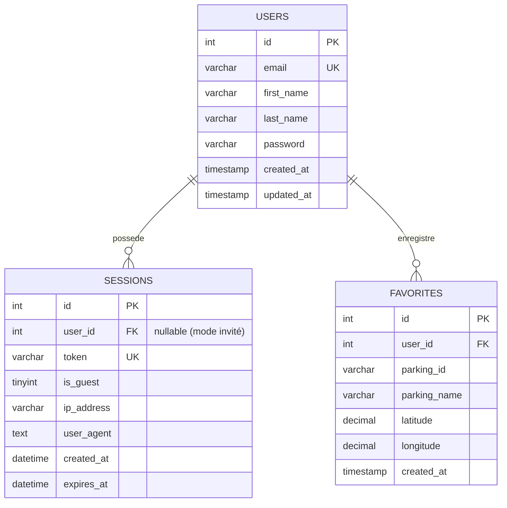

# Parking Finder

<p align="center">
  
  
  
  
  
  
</p>

<p align="center">
  <b>Application web cartographique responsive de géolocalisation, recherche et guidage vers les parkings en temps réel.</b>
  <br />
  <i>Projet full-stack conçu dans le cadre d'un cursus universitaire en BUT Informatique.</i>
</p>

---

## Sommaire

- [Aperçu du projet](#-aperçu-du-projet)
- [Fonctionnalités clés](#-fonctionnalités-clés)
- [Architecture & Conception](#-architecture--conception)
- [Stack Technique](#-stack-technique)
- [Sécurité & Bonnes Pratiques](#-sécurité--bonnes-pratiques)
- [Installation & Démarrage](#-installation--démarrage)
- [Schéma de la Base de Données](#-schéma-de-la-base-de-données)
- [Endpoints de l'API Interne](#-endpoints-de-lapi-interne)
- [Auteur & Contexte](#-auteur--contexte)

---

## Aperçu du projet

**Parking Finder** est une plateforme web conçue pour simplifier le stationnement urbain. L'application agrège des données géographiques mondiales (**OpenStreetMap**) et des flux de données publiques en temps réel (**Open Data des collectivités locales**) afin de fournir aux automobilistes une vue claire, précise et actualisée des places de stationnement disponibles autour d'eux.

L'application intègre également un moteur d'itinéraire et un guidage GPS en temps réel avec assistance vocale.

---

## Fonctionnalités clés

- **Cartographie Interactive & Clustering** : Rendu cartographique fluide sous Leaflet.js avec regroupement dynamique des marqueurs (`Leaflet.markercluster`) pour afficher des milliers de points sans perte de performance.
- **Multi-sources de données en direct** :
  - **OpenStreetMap / Overpass API** : Requêtage spatial mondial (`Overpass QL`) pour localiser les parkings.
  - **Open Data Eurométropole de Metz** : Flux WFS GeoJSON officiel affichant l'occupation et les places disponibles en temps réel.
- **Routage dynamique & Guidage vocal** :
  - Calcul d'itinéraires détaillés pas-à-pas (distance, durée) via l'API **OSRM** (Open Source Routing Machine).
  - Navigation vocale automatique intégrée via la **Web Speech API** (`speechSynthesis`).
- **Moteur de Cache Serveur Intelligent (TTL)** :
  - Système de mise en cache sur disque avec expiration (10 min) réduisant les temps de réponse de 3s à moins de 50ms.
  - Mécanisme de **fallback automatique** : si l'API externe est temporairement indisponible, le dernier cache valide est servi.
- **Gestion Utilisateur & Sécurité** :
  - Authentification par email/mot de passe (hachage **BCRYPT**).
  - Mode **Invité** en un clic pour tester sans inscription.
  - Sessions persistantes sécurisées (*Remember Me* avec jetons uniques et rotation *Sliding Expiration*).
- **Favoris & Export Multi-format** :
  - Sauvegarde personnalisée des parkings préférés.
  - Export direct en **JSON** structuré ou **CSV** (avec BOM UTF-8 pour Excel).
- **Interface Moderne & Ergonomique** :
  - Thème sombre et clair dynamique (sauvegarde dans `localStorage`).
  - Choix du fond de carte (OpenStreetMap standard, CartoDB Dark Matter, vue Satellite ESRI).
  - Barre de recherche avec autocomplétion d'adresses (API Nominatim).
  - Simulation de localisation intégrée pour les démonstrations (Paris, Metz, Londres).

---

## Architecture & Conception

L'application est développée selon le patron d'architecture **MVC (Modèle - Vue - Contrôleur)** en PHP natif sans dépendance externe, garantissant une maîtrise totale du cycle de vie des requêtes.

```
Parking_Finder/
├── api/                        # Proxies autonomes / endpoints legacy
│   └── parking-proxy.php
├── assets/                     # Ressources statiques front-end
│   ├── css/
│   │   └── style.css           # Feuilles de style (variables CSS, glassmorphism)
│   └── js/
│       ├── auth.js             # Gestion AJAX de l'authentification
│       ├── map.js              # Cœur cartographique, clustering, routage, voix
│       └── profile.js          # Gestion du compte, favoris et formulaires
├── cache/                      # Fichiers de cache JSON temporaires (ignorés par Git)
│   └── .gitkeep
├── config/                     # Configuration globale et base de données
│   ├── config.php              # Fichier de configuration active
│   ├── config.example.php      # Fichier modèle pour déploiement
│   └── database.php           # Singleton de connexion PDO
├── controllers/                # Contrôleurs applicatifs (MVC)
│   ├── ApiController.php       # Endpoints AJAX, proxy externe, cache, exports
│   ├── AuthController.php      # Inscription, connexion, mode invité, déconnexion
│   ├── MapController.php       # Affichage et contrôle de la carte
│   └── ProfileController.php   # Profil utilisateur et gestion des favoris
├── models/                     # Modèles de données (POO / PDO)
│   ├── Favorite.php            # CRUD des parkings favoris
│   ├── Session.php             # Gestion des sessions persistantes
│   └── User.php                # Gestion des comptes utilisateurs
├── views/                      # Vues HTML / PHP
│   ├── auth/index.php          # Vue connexion / inscription
│   ├── map/index.php           # Vue principale cartographique
│   └── profile/index.php       # Vue gestion du profil et favoris
├── database.sql                # Script d'initialisation de la BDD MySQL
├── index.php                   # Front Controller (Point d'entrée unique)
├── .gitignore                  # Exclusion des fichiers temporaires/sensibles
├── LICENSE                     # Licence MIT
└── README.md                   # Documentation du projet
```

### Design Patterns implémentés

- **Front Controller (`index.php`)** : Point d'entrée centralisé validant les requêtes, initialisant les sessions et acheminant le flux vers le contrôleur dédié via une liste blanche stricte.
- **Singleton (`Database.php`)** : Instance unique de connexion PDO partagée pendant la requête, évitant la saturation de connexions MySQL.
- **Proxy Pattern (`ApiController`)** : Intermédiaire côté serveur pour les requêtes vers les APIs externes, contournant les blocages **CORS** du navigateur et prévenant les attaques **SSRF**.

---

## Stack Technique

| Domaine | Technologies utilisées |
| :--- | :--- |
| **Back-End** | PHP 8.2 (POO, typage strict, cURL) |
| **Base de Données** | MySQL 8.0 / MariaDB (moteur InnoDB, clés étrangères, index) |
| **Front-End** | Vanilla JavaScript (ES6+ async/await, Fetch API), HTML5, CSS3 |
| **Cartographie** | Leaflet.js 1.9.4, Leaflet.markercluster 1.4.1 |
| **APIs Externes** | OpenStreetMap Overpass, OSRM Routing, Nominatim Geocoding, Metz WFS |
| **Serveur Web** | Apache 2.4 (compatible XAMPP, WAMP, LAMP, Docker) |

---

## Sécurité & Bonnes Pratiques

L'application intègre des mesures strictes respectant les recommandations de l'**OWASP** :

- **Protection contre les Injections SQL** : 100% des requêtes vers la base de données utilisent des requêtes préparées via PDO avec liaison de paramètres (`execute([$param])`).
- **Protection Anti-CSRF** : Génération systématique de jetons cryptographiquement sécurisés (`random_bytes(32)`) et validation stricte avec comparaison à temps constant (`hash_equals()`) pour toutes les actions mutatives.
- **Sécurisation des Mots de Passe** : Hachage fort à sens unique avec l'algorithme natif `BCRYPT` (`password_hash` / `password_verify`).
- **Prévention des failles XSS** : Échappement systématique des données dynamiques affichées (`htmlspecialchars`), typage `application/json` des retours d'API.
- **Sécurisation des Cookies** : Attributs `HttpOnly` pour interdire l'accès aux cookies de session par JavaScript et prévenir le vol de session.
- **Protection SSRF** : Filtrage strict sur liste blanche des URLs cibles au sein du proxy serveur.

---

## Installation & Démarrage

### Prérequis

- [XAMPP](https://www.apachefriends.org/) (ou tout environnement avec **PHP >= 8.0** et **MySQL >= 5.7**)
- [Git](https://git-scm.com/)

### Étapes d'installation

1. **Cloner le projet** dans le dossier web de votre serveur (`htdocs` pour XAMPP) :
   ```bash
   cd c:/xampp/htdocs/
   git clone https://github.com/VOTRE_PSEUDO/Parking_Finder.git
   cd Parking_Finder
   ```

2. **Créer et importer la base de données** :
   - Démarrez **Apache** et **MySQL** depuis le panneau XAMPP.
   - Rendez-vous sur `http://localhost/phpmyadmin`.
   - Créez une nouvelle base de données nommée **`parking_finder`** avec l'interclassement `utf8mb4_unicode_ci`.
   - Importez le fichier **`database.sql`** situé à la racine du projet.
   *(Ou en ligne de commande : `mysql -u root -p parking_finder < database.sql`)*

3. **Vérifier la configuration** :
   - Le fichier `config/config.php` est prêt à l'emploi avec les réglages XAMPP par défaut (`root` sans mot de passe).
   - Si votre configuration MySQL est différente, ajustez les constantes dans `config/config.php` (ou copiez `config/config.example.php`).

4. **Accéder à l'application** :
   - Ouvrez votre navigateur et accédez à :
   ```
   http://localhost/Parking_Finder/
   ```

---

## Schéma de la Base de Données



*Note : La contrainte `UNIQUE (user_id, parking_id)` empêche physiquement l'ajout d'un même parking en doublon dans les favoris d'un utilisateur.*

---

## Endpoints de l'API Interne

Toutes les requêtes AJAX convergent vers `?page=api&action=<ACTION>` :

| Action | Méthode | Description | Auth requise |
| :--- | :---: | :--- | :---: |
| `overpassProxy` | `GET` | Récupère les parkings via OpenStreetMap avec cache serveur | Non |
| `parkingProxy` | `GET` | Proxy vers les APIs temps réel des collectivités (ex: Metz) | Non |
| `addFavorite` | `POST` | Ajoute un parking aux favoris de l'utilisateur | Oui |
| `removeFavorite` | `POST` | Supprime un parking des favoris | Oui |
| `getFavorites` | `GET` | Liste tous les favoris de l'utilisateur connecté | Oui |
| `exportFavorites`| `GET` | Exporte les favoris au format `json` ou `csv` | Oui |
| `sendContact` | `POST` | Envoi d'un message via le formulaire de contact | Non |

---

## Auteur & Contexte

Projet conçu et développé par **Enzo Tribut**, étudiant en **BUT Informatique** (Bachelor Universitaire de Technologie).

Ce projet a été réalisé pour illustrer la mise en pratique de compétences clés :
- Conception orientée objet et patrons d'architecture logicielle (**MVC**, **Singleton**, **Proxy**).
- Consommation et traitement de données géographiques complexes en temps réel.
- Sécurisation et durcissement des applications web contre les vulnérabilités standards.
- Optimisation des performances serveur et client pour le traitement de volumes de données massifs.
